# Agent

Codex. Exact model identifier: not exposed. Run: B.

# Files read

- `AGENTS.md`
- `prompts/1-recover-architecture.md`
- `system/online-boutique/protos/demo.proto`
- `system/online-boutique/kubernetes-manifests/README.md`
- `system/online-boutique/kubernetes-manifests/adservice.yaml`
- `system/online-boutique/kubernetes-manifests/cartservice.yaml`
- `system/online-boutique/kubernetes-manifests/checkoutservice.yaml`
- `system/online-boutique/kubernetes-manifests/currencyservice.yaml`
- `system/online-boutique/kubernetes-manifests/emailservice.yaml`
- `system/online-boutique/kubernetes-manifests/frontend.yaml`
- `system/online-boutique/kubernetes-manifests/kustomization.yaml`
- `system/online-boutique/kubernetes-manifests/loadgenerator.yaml`
- `system/online-boutique/kubernetes-manifests/paymentservice.yaml`
- `system/online-boutique/kubernetes-manifests/productcatalogservice.yaml`
- `system/online-boutique/kubernetes-manifests/recommendationservice.yaml`
- `system/online-boutique/kubernetes-manifests/shippingservice.yaml`

# Containers table

This is a reconstruction of configured architecture, not an observation of a running deployment. The nine backend API responsibilities below describe interfaces defined by `system/online-boutique/protos/demo.proto`; they do not demonstrate successful execution. Application languages are not evidenced in the provided files: neither protobuf code-generation options nor image names establish implementation language. Kubernetes Services and the load balancer route to containers; they are not separate application containers.

| Name | Technology/language | Responsibility | Evidence |
|---|---|---|---|
| frontend | Kubernetes container; image frontend; language not evidenced | Exposes HTTP storefront entry point | system/online-boutique/kubernetes-manifests/frontend.yaml (Deployment frontend; image; httpGet; frontend-external Service) |
| cartservice | Kubernetes container; image cartservice; language not evidenced | Adds, retrieves and empties user carts | system/online-boutique/kubernetes-manifests/cartservice.yaml (Deployment cartservice; image; REDIS_ADDR); system/online-boutique/protos/demo.proto (CartService) |
| productcatalogservice | Kubernetes container; image productcatalogservice; language not evidenced | Lists, retrieves and searches products | system/online-boutique/kubernetes-manifests/productcatalogservice.yaml (Deployment; image); system/online-boutique/protos/demo.proto (ProductCatalogService) |
| recommendationservice | Kubernetes container; image recommendationservice; language not evidenced | Returns recommended product IDs | system/online-boutique/kubernetes-manifests/recommendationservice.yaml (Deployment; image); system/online-boutique/protos/demo.proto (RecommendationService) |
| shippingservice | Kubernetes container; image shippingservice; language not evidenced | Provides shipping quotes and shipment tracking IDs | system/online-boutique/kubernetes-manifests/shippingservice.yaml (Deployment; image); system/online-boutique/protos/demo.proto (ShippingService) |
| currencyservice | Kubernetes container; image currencyservice; language not evidenced | Lists supported currencies and converts money | system/online-boutique/kubernetes-manifests/currencyservice.yaml (Deployment; image); system/online-boutique/protos/demo.proto (CurrencyService) |
| paymentservice | Kubernetes container; image paymentservice; language not evidenced | Accepts charge requests and returns transaction IDs | system/online-boutique/kubernetes-manifests/paymentservice.yaml (Deployment; image); system/online-boutique/protos/demo.proto (PaymentService) |
| emailservice | Kubernetes container; image emailservice; language not evidenced | Accepts order-confirmation email requests | system/online-boutique/kubernetes-manifests/emailservice.yaml (Deployment; image); system/online-boutique/protos/demo.proto (EmailService) |
| checkoutservice | Kubernetes container; image checkoutservice; language not evidenced | Accepts orders and returns order results | system/online-boutique/kubernetes-manifests/checkoutservice.yaml (Deployment; image); system/online-boutique/protos/demo.proto (CheckoutService) |
| adservice | Kubernetes container; image adservice; language not evidenced | Returns ads for supplied context keys | system/online-boutique/kubernetes-manifests/adservice.yaml (Deployment; image); system/online-boutique/protos/demo.proto (AdService) |
| loadgenerator | Kubernetes container; image loadgenerator; BusyBox init container; main language not evidenced | Checks frontend reachability; [Inferred] generates user load | system/online-boutique/kubernetes-manifests/loadgenerator.yaml (Deployment; main image; frontend-check init container; USERS; RATE); system/online-boutique/kubernetes-manifests/kustomization.yaml (loadgenerator resource commented out) |
| redis-cart | Redis; image redis:alpine | Cart-service data store; /data uses emptyDir | system/online-boutique/kubernetes-manifests/cartservice.yaml (Deployment redis-cart; image; volumeMounts; volumes; REDIS_ADDR) |

`loadgenerator` is included because its Deployment is supplied, but `system/online-boutique/kubernetes-manifests/kustomization.yaml` comments out that resource. `system/online-boutique/kubernetes-manifests/README.md` says the manifests require Skaffold image-tag substitution and are not directly deployable as supplied. No external provider or message-broker container is evidenced.

# Dependencies table

Rows represent configured runtime targets; they do not prove an executed call or an RPC sequence. Service-address variables supply caller direction; target Service ports named `grpc`, gRPC probes, and corresponding protobuf service definitions support gRPC. A protobuf service definition alone does not identify its callers or prove which RPC a caller uses. Labels therefore describe APIs, not specific method invocations.

| Caller → callee | Protocol | Relationship label | Evidence |
|---|---|---|---|
| user → frontend | HTTP | Uses storefront | system/online-boutique/kubernetes-manifests/frontend.yaml (frontend-external: LoadBalancer, port name http, 80 to 8080; httpGet probes). [Inferred] end-user role from exposed HTTP frontend. |
| loadgenerator → frontend | HTTP | Checks frontend / targets load | system/online-boutique/kubernetes-manifests/loadgenerator.yaml (FRONTEND_ADDR=frontend:80; frontend-check wget http://${FRONTEND_ADDR}; USERS; RATE). HTTP is explicit for the startup check; main load traffic is inferred. |
| frontend → productcatalogservice | gRPC | Calls product catalog API | system/online-boutique/kubernetes-manifests/frontend.yaml (PRODUCT_CATALOG_SERVICE_ADDR=productcatalogservice:3550); system/online-boutique/kubernetes-manifests/productcatalogservice.yaml (Service port grpc); system/online-boutique/protos/demo.proto (ProductCatalogService) |
| frontend → currencyservice | gRPC | Calls currency API | system/online-boutique/kubernetes-manifests/frontend.yaml (CURRENCY_SERVICE_ADDR=currencyservice:7000); system/online-boutique/kubernetes-manifests/currencyservice.yaml (Service port grpc); system/online-boutique/protos/demo.proto (CurrencyService) |
| frontend → cartservice | gRPC | Calls cart API | system/online-boutique/kubernetes-manifests/frontend.yaml (CART_SERVICE_ADDR=cartservice:7070); system/online-boutique/kubernetes-manifests/cartservice.yaml (Service port grpc); system/online-boutique/protos/demo.proto (CartService) |
| frontend → recommendationservice | gRPC | Calls recommendations API | system/online-boutique/kubernetes-manifests/frontend.yaml (RECOMMENDATION_SERVICE_ADDR=recommendationservice:8080); system/online-boutique/kubernetes-manifests/recommendationservice.yaml (Service port grpc); system/online-boutique/protos/demo.proto (RecommendationService) |
| frontend → shippingservice | gRPC | Calls shipping API | system/online-boutique/kubernetes-manifests/frontend.yaml (SHIPPING_SERVICE_ADDR=shippingservice:50051); system/online-boutique/kubernetes-manifests/shippingservice.yaml (Service port grpc); system/online-boutique/protos/demo.proto (ShippingService) |
| frontend → checkoutservice | gRPC | Calls checkout API | system/online-boutique/kubernetes-manifests/frontend.yaml (CHECKOUT_SERVICE_ADDR=checkoutservice:5050); system/online-boutique/kubernetes-manifests/checkoutservice.yaml (Service port grpc); system/online-boutique/protos/demo.proto (CheckoutService) |
| frontend → adservice | gRPC | Calls ads API | system/online-boutique/kubernetes-manifests/frontend.yaml (AD_SERVICE_ADDR=adservice:9555); system/online-boutique/kubernetes-manifests/adservice.yaml (Service port grpc); system/online-boutique/protos/demo.proto (AdService) |
| checkoutservice → productcatalogservice | gRPC | Calls product catalog API | system/online-boutique/kubernetes-manifests/checkoutservice.yaml (PRODUCT_CATALOG_SERVICE_ADDR=productcatalogservice:3550); system/online-boutique/kubernetes-manifests/productcatalogservice.yaml (Service port grpc); system/online-boutique/protos/demo.proto (ProductCatalogService) |
| checkoutservice → shippingservice | gRPC | Calls shipping API | system/online-boutique/kubernetes-manifests/checkoutservice.yaml (SHIPPING_SERVICE_ADDR=shippingservice:50051); system/online-boutique/kubernetes-manifests/shippingservice.yaml (Service port grpc); system/online-boutique/protos/demo.proto (ShippingService) |
| checkoutservice → paymentservice | gRPC | Calls payment API | system/online-boutique/kubernetes-manifests/checkoutservice.yaml (PAYMENT_SERVICE_ADDR=paymentservice:50051); system/online-boutique/kubernetes-manifests/paymentservice.yaml (Service port grpc); system/online-boutique/protos/demo.proto (PaymentService) |
| checkoutservice → emailservice | gRPC | Calls email API | system/online-boutique/kubernetes-manifests/checkoutservice.yaml (EMAIL_SERVICE_ADDR=emailservice:5000); system/online-boutique/kubernetes-manifests/emailservice.yaml (Service port grpc, 5000 to targetPort 8080); system/online-boutique/protos/demo.proto (EmailService) |
| checkoutservice → currencyservice | gRPC | Calls currency API | system/online-boutique/kubernetes-manifests/checkoutservice.yaml (CURRENCY_SERVICE_ADDR=currencyservice:7000); system/online-boutique/kubernetes-manifests/currencyservice.yaml (Service port grpc); system/online-boutique/protos/demo.proto (CurrencyService) |
| checkoutservice → cartservice | gRPC | Calls cart API | system/online-boutique/kubernetes-manifests/checkoutservice.yaml (CART_SERVICE_ADDR=cartservice:7070); system/online-boutique/kubernetes-manifests/cartservice.yaml (Service port grpc); system/online-boutique/protos/demo.proto (CartService) |
| recommendationservice → productcatalogservice | gRPC | Calls product catalog API | system/online-boutique/kubernetes-manifests/recommendationservice.yaml (PRODUCT_CATALOG_SERVICE_ADDR=productcatalogservice:3550); system/online-boutique/kubernetes-manifests/productcatalogservice.yaml (Service port grpc); system/online-boutique/protos/demo.proto (ProductCatalogService) |
| cartservice → redis-cart | TCP; Redis protocol [Inferred] | Uses cart data store | system/online-boutique/kubernetes-manifests/cartservice.yaml (REDIS_ADDR=redis-cart:6379; redis-cart image redis:alpine; Service port tcp-redis; tcpSocket probes). TCP is evidenced; wire protocol inferred from Redis configuration. |

# Mermaid diagram

The diagram contains exactly the 12 container rows and 17 dependency rows above. The end-user role is inferred from the external HTTP frontend. No separate browser implementation or external provider is established.

```mermaid
C4Container
  title Containers: Online Boutique - run B
  Person(user, "End user [Inferred]", "Uses the exposed HTTP storefront")
  System_Boundary(boutique, "Online Boutique") {
    Container(frontend, "frontend", "Kubernetes container; image frontend; language not evidenced", "Exposes HTTP storefront entry point")
    Container(cartservice, "cartservice", "Kubernetes container; image cartservice; language not evidenced", "Adds, retrieves and empties user carts")
    Container(productcatalogservice, "productcatalogservice", "Kubernetes container; image productcatalogservice; language not evidenced", "Lists, retrieves and searches products")
    Container(recommendationservice, "recommendationservice", "Kubernetes container; image recommendationservice; language not evidenced", "Returns recommended product IDs")
    Container(shippingservice, "shippingservice", "Kubernetes container; image shippingservice; language not evidenced", "Provides shipping quotes and shipment tracking IDs")
    Container(currencyservice, "currencyservice", "Kubernetes container; image currencyservice; language not evidenced", "Lists supported currencies and converts money")
    Container(paymentservice, "paymentservice", "Kubernetes container; image paymentservice; language not evidenced", "Accepts charge requests and returns transaction IDs")
    Container(emailservice, "emailservice", "Kubernetes container; image emailservice; language not evidenced", "Accepts order-confirmation email requests")
    Container(checkoutservice, "checkoutservice", "Kubernetes container; image checkoutservice; language not evidenced", "Accepts orders and returns order results")
    Container(adservice, "adservice", "Kubernetes container; image adservice; language not evidenced", "Returns ads for supplied context keys")
    Container(loadgenerator, "loadgenerator", "Kubernetes container; image loadgenerator; BusyBox init container; main language not evidenced", "Checks frontend reachability; [Inferred] generates user load")
    ContainerDb(redis_cart, "redis-cart", "Redis; image redis:alpine", "Cart-service data store; /data uses emptyDir")
  }
  Rel(user, frontend, "Uses storefront", "HTTP")
  Rel(loadgenerator, frontend, "Checks frontend / targets load", "HTTP")
  Rel(frontend, productcatalogservice, "Calls product catalog API", "gRPC")
  Rel(frontend, currencyservice, "Calls currency API", "gRPC")
  Rel(frontend, cartservice, "Calls cart API", "gRPC")
  Rel(frontend, recommendationservice, "Calls recommendations API", "gRPC")
  Rel(frontend, shippingservice, "Calls shipping API", "gRPC")
  Rel(frontend, checkoutservice, "Calls checkout API", "gRPC")
  Rel(frontend, adservice, "Calls ads API", "gRPC")
  Rel(checkoutservice, productcatalogservice, "Calls product catalog API", "gRPC")
  Rel(checkoutservice, shippingservice, "Calls shipping API", "gRPC")
  Rel(checkoutservice, paymentservice, "Calls payment API", "gRPC")
  Rel(checkoutservice, emailservice, "Calls email API", "gRPC")
  Rel(checkoutservice, currencyservice, "Calls currency API", "gRPC")
  Rel(checkoutservice, cartservice, "Calls cart API", "gRPC")
  Rel(recommendationservice, productcatalogservice, "Calls product catalog API", "gRPC")
  Rel(cartservice, redis_cart, "Uses cart data store", "TCP; Redis protocol [Inferred]")
  UpdateLayoutConfig($c4ShapeInRow="3", $c4BoundaryInRow="1")
```

# Gaps

| Gap | Evidence boundary | Extra file that would settle it |
|---|---|---|
| Implementation languages, frameworks and concrete image versions | Not evidenced in the provided files. `demo.proto` declares `go_package`, but this is a generation option, not proof that every service is Go. Application images are symbolic names. | Each application image’s Dockerfile/build definition and image-tag configuration; exact paths not evidenced here. |
| Actual RPC use, call order, failure handling and whether configured targets are contacted | Not evidenced in the provided files. Environment variables establish configured destinations, while protobuf defines possible operations. | Caller implementation files for frontend, checkoutservice and recommendationservice; exact paths not evidenced here. Execution traces would establish actual calls. |
| Shopping assistant | `system/online-boutique/kubernetes-manifests/frontend.yaml` sets `SHOPPING_ASSISTANT_SERVICE_ADDR=shoppingassistantservice:80`, but `ENABLE_ASSISTANT` is commented out. No shoppingassistant Deployment or API occurs in the supplied evidence. Enabled runtime dependency, responsibility and protocol are not established; omitted from tables and diagram. | Frontend assistant feature-gating/client implementation file and the shoppingassistant Deployment/API file; exact paths not evidenced here. |
| Optional packaging service | `system/online-boutique/kubernetes-manifests/frontend.yaml` mentions an optional packaging service only in comments; `PACKAGING_SERVICE_URL` is commented out. No configured deployment/dependency is established. | An enabled packaging configuration file and its deployment/client implementation file; exact paths not evidenced here. |
| Load generation during a real deployment | `system/online-boutique/kubernetes-manifests/loadgenerator.yaml` supplies a Deployment and an explicit HTTP startup check; its resource is commented out in `kustomization.yaml`. Main-container HTTP load behavior and actual inclusion are not proved. | The Skaffold configuration mentioned in `system/online-boutique/kubernetes-manifests/README.md` and `kustomization.yaml`, plus loadgenerator implementation file; exact implementation path not evidenced here. |
| Redis persistence guarantees and client wire details | `system/online-boutique/kubernetes-manifests/cartservice.yaml` uses `redis:alpine`, TCP 6379 and `/data` backed by `emptyDir`. Durable cross-Pod persistence, stored schema, TTLs, and exact client protocol/TLS are not evidenced in the provided files. | Cart Redis client implementation/configuration file and any persistence override manifest; exact paths not evidenced here. |
| External payment, email, shipping or advertising providers; catalog storage; order persistence; broker | Not evidenced in the provided files. API names do not prove third-party integrations or databases. No such extra nodes/edges are drawn. | Respective service implementation/configuration files and any additional deployment manifests; exact paths not evidenced here. |
| Tracing, profiling and service mesh runtime infrastructure | Profiler flags and the frontend/loadgenerator `sidecar.istio.io/rewriteAppHTTPProbers` annotations do not prove deployed collectors, profiler backends or mesh containers. None is shown. | Instrumentation client configuration and collector/mesh deployment files; exact paths not evidenced here. |
| End-user identity, browser technology, HTTPS and authentication | Frontend exposes an HTTP LoadBalancer on 80 to 8080 and HTTP health checks. A human storefront user is inferred; browser code, HTTPS termination and authentication are not evidenced in the provided files. | Frontend page/route/authentication implementation file and any ingress/TLS manifest; exact paths not evidenced here. |
